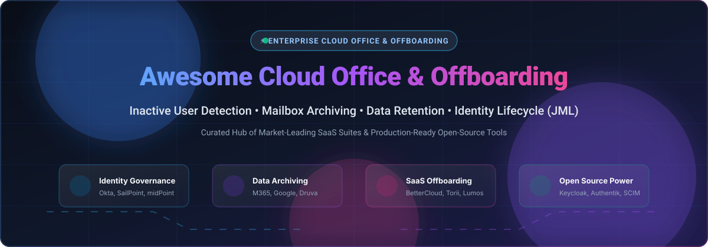

<div align="center">

<a href="https://github.com/ishandutta2007/Awesome-Awesome-Awesome"></a><a href="https://discord.gg/jc4xtF58Ve"></a>
<a href="https://github.com/ishandutta2007/Awesome-Integrated-Cloud-Office-Suite-Collaboration/stargazers"></a>
<a href="https://github.com/ishandutta2007/Awesome-Integrated-Cloud-Office-Suite-Collaboration/network/members"></a>
<a href="https://github.com/ishandutta2007/Awesome-Integrated-Cloud-Office-Suite-Collaboration/issues"></a>
<a href="https://github.com/ishandutta2007/Awesome-Integrated-Cloud-Office-Suite-Collaboration/blob/main/LICENSE"></a>
<a href="https://github.com/ishandutta2007"></a>

<br/><br/>

<a href="https://github.com/ishandutta2007/Awesome-Integrated-Cloud-Office-Suite-Collaboration">
  
</a>

# 🏢 Awesome Integrated Cloud Office Suite Collaboration &amp; Offboarding 🚀

### 🌟 Top Inactive User Data Archiving, SaaS Offboarding &amp; Identity Lifecycle Ecosystem 🔐

**Curated List of SaaS Products &amp; Open-Source GitHub Projects**  
*Focused on Inactive User Detection, Automated Offboarding Workflows, Data Retention, Mailbox Archiving &amp; Joiner-Mover-Leaver (JML) Identity Lifecycle Governance*

[](http://makeapullrequest.com)
[](https://github.com/ishandutta2007/Awesome-Integrated-Cloud-Office-Suite-Collaboration/graphs/commit-activity)
[](https://github.com/ishandutta2007/Awesome-Integrated-Cloud-Office-Suite-Collaboration)

</div>

---

## 📖 Overview &amp; SEO Summary

Welcome to the definitive, SEO-optimized repository cataloging **Cloud Office Collaboration**, **Inactive User Management**, **SaaS Offboarding Automation**, and **Enterprise Data Archival Solutions**. 

Managing employee exits and dormant cloud accounts is crucial for modern IT, DevOps, and SecOps teams. Unattended inactive accounts present critical security risks (orphaned credentials, credential stuffing) and unnecessary software license expenditures. This directory provides a side-by-side comparison of **enterprise commercial SaaS suites** and **production-ready open-source platforms** that streamline:
- 🕵️ **Inactive Account &amp; Shadow SaaS Detection**: Identifying stale Google Workspace, Microsoft 365, and enterprise SaaS accounts.
- 🔄 **Joiner-Mover-Leaver (JML) Workflows**: Synchronizing HRIS changes (BambooHR, Workday, Rippling) directly to IAM / IdP targets.
- 📦 **Automated Data Archival &amp; Legal Hold**: Retaining Exchange Online inactive mailboxes, Google Drive assets, and Druva cloud backups.
- ✂️ **One-Click SaaS Access Revocation**: Automated SCIM provisioning and API-driven deprovisioning across dozens of cloud apps.

---

## 📑 Table of Contents
- [📊 Sector Overview &amp; Market Dynamics](#-sector-overview--market-dynamics)
- [☁️ SaaS &amp; Commercial Hosted Platforms](#️-saas--commercial-hosted-platforms)
- [💻 Open-Source GitHub Projects](#-open-source-github-projects)
- [🏗️ Architectural Implementation Patterns](#️-architectural-implementation-patterns)
- [🤝 How to Contribute](#-how-to-contribute)
- [💖 Support &amp; Sponsorship](#-support--sponsorship)
- [⭐ Star History](#-star-history)
- [⚖️ Disclaimer](#️-disclaimer)

---

## 📊 Sector Overview &amp; Market Dynamics

> 💡 **Market Size &amp; Growth**: The global SaaS Management Platform (SMP) and Identity Governance &amp; Administration (IGA) sector is projected to exceed **$32.5 Billion** by 2028, growing at a rapid CAGR of over 18.4%, driven by zero-trust mandates, hybrid workforces, and multi-SaaS sprawl.  
> 
> 🧩 **Market Dynamics**: The sector is **moderately fragmented**: mega-cap hyper-scalers (Microsoft, Alphabet) dominate baseline productivity and mailbox archiving; specialized publicly traded leaders (Okta, SailPoint) capture enterprise identity governance; while high-growth innovators (BetterCloud, Lumos, Torii, Rippling) compete aggressively in workflow orchestration, HRIS sync, and automated app deprovisioning.

---

## ☁️ SaaS &amp; Commercial Hosted Platforms

*Sorted by Company Size / Valuation / Market Capitalization (Descending).*

| 🏢 Platform | 🌐 Primary Website | 💰 Valuation / Revenue Scale | 💵 Starting Tier Pricing | 🎁 Free Tier / Trial Limits | 🔑 Key Offboarding &amp; Archival Capabilities |
| :--- | :--- | :--- | :--- | :--- | :--- |
| **Microsoft 365** | [microsoft.com](https://www.microsoft.com/en-us/microsoft-365) | ~$3.1 Trillion Market Cap | **$6.00 / user / month** (Business Basic, annual commitment) | **30-Day Free Trial** (up to 25 user licenses) | Retain departed employee Exchange mailboxes with Exchange Online Inactive Mailboxes &amp; compliance retention policies without ongoing license fees. |
| **Google Workspace** | [workspace.google.com](https://workspace.google.com/) | ~$2.1 Trillion Market Cap (Alphabet) | **$6.00 / user / month** (Business Starter, 1-yr commitment) | **14-Day Free Trial** (up to 10 user accounts) | Centralized admin console inactive account audit reports, suspended user archive policies, and automated Google Drive ownership reassignment. |
| **Okta Lifecycle Management** | [okta.com](https://www.okta.com/) | ~$14.5 Billion Market Cap | **$4.00 / user / month** (Lifecycle Management base add-on) | **30-Day Free Trial** (full Okta Workforce Identity Cloud tenant) | Automated Joiner-Mover-Leaver (JML) provisioning &amp; deprovisioning rules, Okta Workflows integration, and multi-app access revocation. |
| **Rippling** | [rippling.com](https://www.rippling.com/) | ~$13.5 Billion Valuation | **$8.00 / employee / month** (plus base platform fee) | **Interactive Demo / Custom Pilot** (14-day assisted PoC) | Unified HRIS &amp; IT cloud: auto-triggers app suspension, remote laptop locking, and credential wiping the exact instant employee termination takes effect. |
| **SailPoint** | [sailpoint.com](https://www.sailpoint.com/) | ~$6.9 Billion Valuation (Thoma Bravo) | **$5.00 / identity / month** (Atlas Cloud starting baseline) | **30-Day Guided Sandbox** (enterprise PoC environment) | Enterprise-grade identity governance (IGA), JML certification campaigns, dormant entitlement discovery, and automated SOD compliance enforcement. |
| **Druva Data Resiliency Cloud** | [druva.com](https://www.druva.com/) | ~$2.0 Billion Valuation | **$2.50 / user / month** (Microsoft 365 &amp; Google Workspace backup tier) | **30-Day Free Trial** (up to 100GB backup storage capacity) | Dedicated departed-user data retention, immutable cloud backup for Google Drive / OneDrive / Exchange, and regulatory eDiscovery legal hold. |
| **BambooHR** | [bamboohr.com](https://www.bamboohr.com/) | ~$1.2 Billion Valuation | **$5.25 / employee / month** (Essentials tier starting base) | **7-Day Free Trial** (full access with sample workforce data) | Employee offboarding checklists, task escalation for IT equipment retrieval, and automated webhook triggers for downstream IAM deactivation. |
| **BetterCloud** | [bettercloud.com](https://www.bettercloud.com/) | ~$750 Million Valuation | **$3.00 / user / month** (Core SaaS Management baseline) | **14-Day Free Trial** (cloud connector sandbox environment) | Multi-SaaS automated offboarding pipelines: reassigns Google/M365 files, revokes Slack &amp; GitHub seat licenses, and archives user inbox data. |
| **Torii** | [toriihq.com](https://www.toriihq.com/) | ~$300 Million Valuation | **$2.50 / user / month** (Starter Tier annual plan) | **14-Day Free Trial** (automated SaaS discovery &amp; connector scan) | Continuous shadow IT discovery, automated offboarding workflow builder with multi-step app deprovisioning and spend optimization. |
| **Lumos** | [lumos.com](https://www.lumos.com/) | ~$250 Million Valuation | **$3.50 / user / month** (Identity Governance Starter tier) | **14-Day Free Trial** (connect up to 10 core enterprise apps) | Self-service AppStore, automated inactive license reclamation, and one-click employee offboarding with audit-proof compliance logging. |

---

## 💻 Open-Source GitHub Projects

*Sorted by GitHub Stars_Count (Descending).*

| 🛠️ Repository | ⭐ GitHub_Stars | 📜 License | 🎯 Category | 🔍 Description &amp; Offboarding Utility |
| :--- | :--- | :--- | :--- | :--- |
| **[Keycloak](https://github.com/keycloak/keycloak)** | [](https://github.com/keycloak/keycloak/stargazers) | Apache-2.0 | IdP / IAM Core | Industry standard open-source Identity Provider. Provides event listener SPIs, REST admin APIs, and user federation to automate account deactivation, session revocation, and leaver policies. |
| **[Nextcloud Server](https://github.com/nextcloud/server)** | [](https://github.com/nextcloud/server/stargazers) | AGPL-3.0 | Cloud Collaboration | Self-hosted productivity suite featuring complete data retention controls, automated account expiration, user file ownership transfer commands (`occ files:transfer-ownership`), and trashbin retention. |
| **[Authelia](https://github.com/authelia/authelia)** | [](https://github.com/authelia/authelia/stargazers) | Apache-2.0 | Auth &amp; SSO | Single Sign-On multi-factor portal. Allows security teams to instantly terminate active sessions, ban inactive usernames, and revoke access keys across internal applications. |
| **[Authentik](https://github.com/goauthentik/authentik)** | [](https://github.com/goauthentik/authentik/stargazers) | GPL-3.0 | IdP &amp; Orchestration | Modern open-source identity provider with built-in SCIM server/client, visual flow editor, and stage bindings capable of triggering custom deprovisioning pipelines upon user suspension. |
| **[Teleport](https://github.com/gravitational/teleport)** | [](https://github.com/gravitational/teleport/stargazers) | AGPL-3.0 | Zero-Trust Infrastructure | Zero-trust access plane for SSH, Kubernetes, databases, and internal web applications with automated identity-based access termination and session recording. |
| **[Zitadel](https://github.com/zitadel/zitadel)** | [](https://github.com/zitadel/zitadel/stargazers) | Apache-2.0 | Cloud-Native IdP | Cloud-native multi-tenant identity infrastructure with complete audit trails, user state lifecycles (`SUSPEND`, `REMOVE`), and webhook event delivery for downstream archiving. |
| **[Casdoor](https://github.com/casdoor/casdoor)** | [](https://github.com/casdoor/casdoor/stargazers) | Apache-2.0 | UI-First IAM / SSO | Web-based IAM platform supporting OAuth 2.0, OIDC, SAML, and CAS with built-in user management, role sync, and instant account lockout APIs. |
| **[Ory Kratos](https://github.com/ory/kratos)** | [](https://github.com/ory/kratos/stargazers) | Apache-2.0 | Identity &amp; User Mgmt | Cloud-native headless identity engine providing robust account state machine management (`active`, `inactive`), session termination APIs, and webhook triggers for offboarding scripts. |
| **[Mailcow: Dockerized](https://github.com/mailcow/mailcow-dockerized)** | [](https://github.com/mailcow/mailcow-dockerized/stargazers) | GPL-3.0 | Mail Server &amp; Archive | Complete containerized groupware and mail server suite with REST APIs for automated mailbox deactivation, mail export, forwarding, and compliance archiving. |
| **[Dex IdP](https://github.com/dexidp/dex)** | [](https://github.com/dexidp/dex/stargazers) | Apache-2.0 | Federated OIDC | Pluggable OIDC connector driving federated authentication. Offboarding an upstream LDAP/Active Directory account cascades immediate access cutoff across all downstream Dex clients. |
| **[Kanidm](https://github.com/kanidm/kanidm)** | [](https://github.com/kanidm/kanidm/stargazers) | MPL-2.0 | Fast Directory &amp; Auth | Fast, secure identity management system written in Rust with POSIX integration, OAuth2, and native CLI controls for locking dormant accounts and invalidating session tokens. |
| **[FreeIPA](https://github.com/freeipa/freeipa)** | [](https://github.com/freeipa/freeipa/stargazers) | GPL-3.0 | Linux Domain IAM | Centralized enterprise information management combining 389 Directory Server, MIT Kerberos, and Dogtag CA with dedicated user deactivation, preservation stages, and HBAC rules. |
| **[Janssen Project (Jans)](https://github.com/JanssenProject/jans)** | [](https://github.com/JanssenProject/jans/stargazers) | Apache-2.0 | High-Scale IAM | Linux Foundation open-source identity suite engineered for ultra-high-throughput enterprise IAM, OAuth2 token revocation, and compliance-driven authorization. |
| **[midPoint](https://github.com/Evolveum/midpoint)** | [](https://github.com/Evolveum/midpoint/stargazers) | EUPL-1.2 | Enterprise IGA Platform | The most comprehensive open-source Identity Governance and Administration (IGA) platform. Provides end-to-end Joiner-Mover-Leaver (JML), role mining, and connector-driven deprovisioning. |
| **[Apache Syncope](https://github.com/apache/syncope)** | [](https://github.com/apache/syncope/stargazers) | Apache-2.0 | Digital Identity Mgmt | Enterprise system for identity lifecycle management, access provisioning, user reconciliation, and bi-directional SCIM synchronization. |
| **[Elimity SCIM](https://github.com/elimity-com/scim)** | [](https://github.com/elimity-com/scim/stargazers) | Apache-2.0 | SCIM v2.0 Protocol | Production-grade Go implementation of the SCIM v2.0 specification (RFC 7643 / RFC 7644) for building standardized SaaS user deprovisioning connectors. |

---

## 🏗️ Architectural Implementation Patterns

```
   ┌─────────────────────────────────────────────────────────────┐
   │             HRIS / Source of Truth (Leaver Event)           │
   │            (BambooHR, Rippling, Workday, etc.)              │
   └──────────────────────────────┬──────────────────────────────┘
                                  │ Webhook / Scheduled Polling
                                  ▼
   ┌─────────────────────────────────────────────────────────────┐
   │            Identity Governance & Lifecycle Engine           │
   │       (Okta Workflows / midPoint / Authentik / Syncope)      │
   └──────┬───────────────────────┬───────────────────────┬──────┘
          │                       │                       │
          ▼ SCIM / REST API       ▼ Google/M365 API       ▼ Backup API
   ┌───────────────┐      ┌───────────────┐      ┌───────────────┐
   │ Revoke App    │      │ Archive Mail  │      │ Immutable     │
   │ Access &amp; Keys │      │ &amp; Transfer    │      │ Storage Hold  │
   │ (SaaS Apps)   │      │ Files (Drive) │      │ (Druva/Cloud) │
   └───────────────┘      └───────────────┘      └───────────────┘
```

1. **Detection &amp; Signal Ingestion**: Last-login inactivity audit scripts or direct HRIS webhooks register employee resignation or leave of absence.
2. **Account Suspension**: The Identity Provider (IdP) immediately suspends user state, kills active sessions, and revokes MFA factors.
3. **Automated SCIM Deprovisioning**: Outbound SCIM calls cascade user deactivation across Salesforce, Slack, GitHub, and corporate SaaS.
4. **Data Ownership Reassignment**: Cloud office assets (Google Docs, OneDrive folders) are transferred to managers or team leads.
5. **Compliant Archiving**: Mailboxes are converted to shared mailboxes or Microsoft 365 Inactive Mailboxes, with retention locks applied for legal hold.

---

## 🤝 How to Contribute

We actively welcome contributions to expand this guide! 🎉

1. 🍴 **Fork the repository** on GitHub.
2. 🌿 **Create a new branch** (`git checkout -b feature/add-new-tool`).
3. 📝 **Add or update entries** in `README.md` following the standard table schema:
   - For **SaaS**: Include product name, official URL, company valuation/scale, exact starting tier price, and specific free tier/trial limits.
   - For **Open-Source**: Include repository link, GitHub Stars_Badge, license, category, and architectural description.
4. 🚀 **Submit a Pull Request** with a concise description of your additions.

---

## 💖 Support &amp; Sponsorship

If this curated guide saves you time, prevents data leakage, or helps streamline your IT operations:

- ⭐ **Star this repository** to show your appreciation and boost discoverability!
- 🍴 **Fork and share** with fellow IT administrators, DevOps engineers, and security teams.
- ☕ **Buy me a coffee**: Support ongoing maintenance and research via my [GitHub Sponsor Dashboard](https://github.com/sponsors/ishandutta2007).

---

## ⭐ Star History

[](https://www.star-history.com/#ishandutta2007/Awesome-Integrated-Cloud-Office-Suite-Collaboration&type=date&legend=top-left)

---

## ⚖️ Disclaimer

- 📌 This repository is a **community-curated directory** provided for educational, informational, and architectural evaluation purposes.
- ⚖️ Offboarding workflows and data archiving handle sensitive employee data and are subject to strict employment regulations, labor privacy rights, and compliance laws (e.g., GDPR, CCPA, HIPAA, SOC 2). Always review retention procedures with your organization's legal and security counsel.
- 🏷️ All product names, logos, and trademarks belong to their respective owners.

---

<div align="center">
  <b>Built with ❤️ for IT Ops, SecOps, Identity Engineers, and Open-Source Advocates.</b>
</div>
